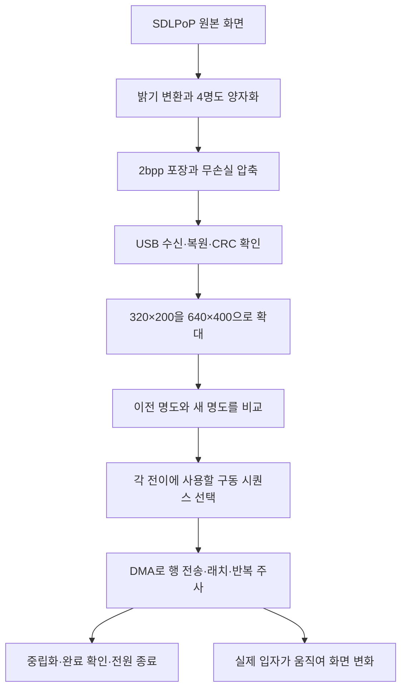

# 전자종이 구동 구조와 개선 가능성

작성: 2026-10-05. 대상: Screen-4.7-S3 V2.4/H716, ESP32-S3, 960×540 패널. 게임 표시 영역은 640×400, 최근 비교는 4명도다.

이 문서는 구현 재개 계획이 아니라, 기존 결과를 이해하고 다음 투자를 판단하기 위한 기술 설명이다. 보드 시험·펌웨어 변경은 수행하지 않았다.

## 1. 먼저 판단할 내용

**드라이버 교체로 큰 개선은 이미 있었다.** 제조사 LilyGo-EPD47에서 EPD_Painter로 바꾸면서 전송 구조뿐 아니라 픽셀을 구동하는 파형과 전이 방식까지 달라졌다. 현재의 한계는 제조사 드라이버를 그대로 두고 대기 시간만 줄인 결과가 아니다.

**NORMAL과 FAST는 같은 그림을 다른 속도로 보내는 설정만이 아니다.** 밝기 전환에 사용하는 전압 방향·횟수·유지 시간이 다르다. NORMAL은 이번 짧은 시험에서 잔상이 없고 명암이 개선됐지만 느렸다. FAST는 목표에 가까운 처리 시간을 냈지만 이동 자국이 남았다.

**획기적으로 달라질 구조는 존재한다.** 픽셀별 진행 상태를 관리하고 진행 중인 전이를 새 입력에 맞춰 수정하는 컨트롤러가 예다. 그러나 현재 보드에서 옵션을 켜거나 다른 라이브러리를 설치하면 해결된다는 근거는 없다. 남은 작업은 파형 계측·재보정 또는 컨트롤러 재설계에 가깝다.

따라서 “패널의 물리적 한계가 증명됐다”는 결론도, “조금만 더 최적화하면 해결된다”는 결론도 맞지 않는다. 현재 근거로는 기존 보드의 무기한 개선 반복을 권하지 않는다.

## 2. 화면 한 장이 표시되는 과정

마지막 두 경로를 구별해야 한다. 프로그램은 구동 작업이 끝난 것을 알지만, 화면의 실제 반사 밝기를 읽지는 못한다. ACK·CRC·프레임 해시가 정상이더라도 광학적인 잔상은 남을 수 있다.

| 용어 | 이 프로젝트에서의 뜻 |
| --- | --- |
| 게임 프레임 | 게임이 만든 한 시점의 이미지. 모두 디스플레이에 전달되는 것은 아니다 |
| 갱신 완료 간격 | 연속 ACK 사이 시간. 수신·준비·구동 등의 비용을 포함한다 |
| 주사/pass | 패널 행들을 한 차례 순회해 구동 코드를 주는 작업. 이미지 한 장에 여러 번 필요하다 |
| 파형/train | 한 픽셀에 여러 주사 동안 적용할 어둡게·밝게·무구동 코드의 배열 |
| 명도 | 목표 밝기. 최근 입력은 0=흰색, 1=밝은 회색, 2=어두운 회색, 3=검정 |
| 광학 응답 | 실제 화면이 목표 밝기로 변하는 과정. 현재 시간 로그만으로 측정되지 않는다 |

**입력의 2bpp는 네 가지 목표 명도이고, 패널로 보내는 2비트 코드는 그 순간의 구동 지시다. 둘은 다른 정보다.** 회색은 회색 데이터를 한 번 보내서 만들어지는 것이 아니라 여러 구동 단계의 결과다.

## 3. 제조사 드라이버에서 무엇이 달라졌나

| 항목 | LilyGo-EPD47의 당시 차분 구현 | EPD_Painter의 현재 시험 경로 |
| --- | --- | --- |
| 목표 이미지 | 점무늬로 명암을 표현하는 흑백 차분 | 실제 4명도, 최근 입력은 디더링 없음 |
| 변화 처리 | 흰색 구동 15회와 검정 구동 15회 | 이전→다음 명도별 시퀀스 선택, 밝게/어둡게 할 픽셀을 같은 행에 합침 |
| 전송·제어 | S3의 SDK LCD I80 경로, 호출별 작업 생성·동기화와 RMT 제어 | LCD_CAM/GDMA 직접 제어, 상주 작업, 이중 행 버퍼, SIMD 변환 |
| 회색 사이 전환 | 당시 흑백 경로에는 해당 없음 | 중간 흰색을 거치거나 직접 전이 표 사용 가능. 최근 비교는 직접 전이 |
| 남는 제약 | 30회 주사와 전송·호출 비용 | 전이별 주사 횟수·유지 시간, 계산·메모리 접근, 실제 패널 반응 |

당시 제조사 경로는 400개 활성 행·30회·10MHz 조건에서 데이터 전송만 약 299ms가 필요했다. LCD 콜백 반환 계약을 바로잡아 표시 처리 평균은 687.038→679.455ms로 줄었지만, 구조적 병목은 남았다. 이후 EPD_Painter로 바꾼 것이 큰 구조 변경이다. 서로 다른 입력·모드의 제조사 표시 시간과 최신 ACK 시간을 나눠 정밀한 개선 배율로 사용하면 안 된다.

근거: [제조사 드라이버 병목 분석](드라이버-병목-분석.md), [핀·전원·고속 드라이버 호환성 검토](고속-드라이버-호환성-검토.md).

## 4. NORMAL과 FAST의 정확한 차이

여기서 NORMAL/FAST는 **EPD_Painter의 H716용 4명도 설정**이다. 다른 제조사나 드라이버의 같은 이름과 동일한 규격이 아니다. 두 모드 모두 최근 시험에서는 직접 회색 전이를 사용했다.

| 항목 | NORMAL | FAST |
| --- | --- | --- |
| 기본 흰색↔각 명도 표 길이 | 13슬롯 | 7슬롯 |
| 직접 전이에 따른 확장 | 최대 19슬롯인 전이가 있음 | 최대 12슬롯인 전이가 있음 |
| 4명도 주사 사이 추가 시간 | 4,000µs | 해당 추가 대기 없음 |
| 파형 | NORMAL 전용 방향·횟수 배열 | FAST 전용 방향·횟수 배열 |
| 이번 관찰 | 잔상 없음, 흐릿함 크게 개선. 이동 중 플레이어가 하얗게 보이고 느림 | 빠르지만 이동 자국·흐릿함이 남음 |

추가 대기가 없다는 말은 전압 유지 시간이 0이라는 뜻이 아니다. 한 행을 래치하면 다음 주사에서 그 행이 다시 갱신될 때까지 픽셀의 전기적 상태가 유지된다. 주사 자체에 드는 시간도 구동량에 영향을 준다. 따라서 4ms를 삭제하거나 DMA를 빨리 돌리면 기존 파형과 같은 밝기가 나온다고 보장할 수 없다.

일부 직접 전이의 실제 표 길이는 다음과 같다. 전체 작업의 횟수는 기본 길이와 사용 중인 전이들 중 가장 긴 길이에 의해 결정된다.

| 전이 | NORMAL | FAST |
| --- | ---: | ---: |
| 밝은 회색→검정(1→3) | 17 | 11 |
| 어두운 회색→검정(2→3) | 15 | 12 |
| 검정→밝은 회색(3→1) | 15 | 5 |
| 검정→어두운 회색(3→2) | 19 | 8 |

예를 들어 NORMAL의 검정→어두운 회색은 밝게 하는 14단계 뒤 어둡게 하는 5단계를 사용한다. 목표보다 밝은 쪽으로 갔다가 돌아오는 방식이다. FAST는 별도의 짧은 배열을 쓴다. 단순히 NORMAL의 뒤쪽을 잘라낸 모드가 아니다.

현재 엔진은 매 주사에 540행을 순회한다. 변경하지 않는 픽셀에는 무구동 코드를 쓰고, 변경 청크 마스크로 계산을 줄인다. **검정→어두운 회색 픽셀 하나가 있어도 NORMAL의 전체 주사가 19회까지 길어질 수 있다.** 작은 플레이어만 움직인다고 시간이 면적에 비례해 줄지 않는 이유다.

### 4명도와 16계조를 혼동하면 안 되는 부분

H716 프리셋의 `g16_pass_us_normal=20000`은 **16계조용 고정 주기**다. 현재 4명도 NORMAL이 매번 20ms 주기로 돈다는 뜻이 아니다. 4명도는 행 주사 시간에 4ms를 더하는 경로다. FAST의 16계조 조합은 구현에서 거부한다. HIGH도 있지만 현재 4명도 게임의 해결책으로 검증하지 않았다.

명도 번호가 같아도 모드별 실제 밝기가 같지는 않다. 프리셋의 4명도 밝기 보정 포인터는 FAST용 값을 가리킨다. 다만 우리 경로는 이미 양자화한 2bpp를 직접 넣으므로 그 포인터만 바꿔서는 현재 입력이나 잔상이 바뀌지 않는다.

근거: [H716 파형](../repos/EPD_Painter/src/LilyGo_H716_Trains.h), [모드 선택·실행 코드](../repos/EPD_Painter/src/EPD_Painter.cpp), [타이밍 기본값](../repos/EPD_Painter/src/EPD_Painter.h), [H716 프리셋](../repos/EPD_Painter/src/EPD_Painter_presets.h).

## 5. 우리가 개선한 것과 개선하지 못한 것

| 작업 | 실제 효과와 한계 |
| --- | --- |
| RGB→4명도 변환 캐시·네이티브 처리 | 같은 결과 비트를 더 빨리 생성. 패널의 입자 반응은 바뀌지 않음 |
| 2bpp 전송·무손실 행 패치/RLE/LZ | USB 데이터 감소. 복원 이미지·CRC를 비교했으며 화질을 낮추는 압축이 아님 |
| 증분 확대·영역 복사 | 바뀐 입력의 준비 비용 감소 |
| 직접 회색 전이·불필요한 두 번째 구동 제거 | 중간 흰색 경유를 줄여 구동 비용 감소. 직접 전이만으로 잔상은 해결되지 않음 |
| 행·픽셀쌍·동일 바이트의 결정 결과 재사용 | 동일 구동 결정을 빠르게 계산. 명목 파형은 유지하지만 시간 변경의 광학 영향은 별도 확인 대상 |
| 완료·전원OFF·진단 계측 | 호출 반환과 구동 완료를 구별. 안전한 제한 시험과 병목 분석에 필요 |
| FAST 흰색/검정 보정 후보 | 일부 전이의 구동 배열 변경. 마지막 게임 비교에서 이동 자국 개선 실패 |

같은 원본 40~51번 비교에서 NORMAL ACK 평균은 275.362→208.155ms로 약 24.4% 감소했다. 이 구간은 실제로 유효한 개선이었다. 하지만 이후 시간 예산을 분해하니 **주사와 그 사이 대기만 평균 176.290ms**였다. 이 타이밍을 유지하면 나머지 비용을 모두 없애도 100ms에 도달할 수 없다. 이는 현재 파형·타이밍에 대한 조건부 한계이며 패널 자체의 절대 한계는 아니다.

| 기록 | ACK 평균 / p95 | 판정 |
| --- | --- | --- |
| NORMAL 동일 입력 최적화 후 | 208.155 / 209.971ms | 약 4.80장/초, 속도 목표 미달 |
| 마지막 FAST A: 흰색 보정 2쌍 | 92.359 / 94.945ms | 이 짧은 입력의 시간 기준 충족 |
| 마지막 FAST B: A + 검정 보정 2쌍 | 92.780 / 95.820ms | 시간 기준 충족, 사용자 “자국이 거의 그대로임”으로 후보 기각 |

목표는 변경 화면 ACK 평균≤100ms·p95≤125ms와 NORMAL 수준의 화질을 함께 만족하는 것이었다. **FAST의 약 10.8장/초는 잔상 없는 10.8fps 게임의 증명이 아니다.** 더 넓은 실시간 입력에서의 시간 기준도 짧은 고정 클립 결과로 대체할 수 없다. 또한 이 목표 자체가 PoP를 불편 없이 플레이하기에 충분하다는 사용자 검증도 끝나지 않았다.

근거: [성능 개선 반복 기록](성능-개선-반복.md)의 9·10회 시간 예산과 마지막 32회 A/B 결과. NORMAL 관찰은 [제한 시험 기록](EPD-Painter-제한-시험.md) 참조.

## 6. 왜 플레이어의 이동 자국이 남나

확인된 사실은 다음과 같다.

- 전송 이미지·복원 비트·CRC가 일치해도 FAST에서 이동 경로가 남았다.
- 동일 계열 입력의 NORMAL에서는 사용자가 잔상이 없다고 관찰했다.
- 제조사 전체 정리로 과거 흔적이 사라진 사례가 있다.

따라서 단순 USB 데이터 손상보다 **선택한 구동 조건과 실제 픽셀 상태 사이 불일치**가 주요 의심 대상이다. 다만 현재 자료로 원인을 한 가지로 확정할 수는 없다.

소프트웨어는 “지난번에 명도 2를 그렸으니 지금도 명도 2”라고 간주한다. 실제 픽셀이 충분히 이동하지 않았거나 이전 구동 이력에 따라 다른 밝기에 도착해도 그 차이를 읽지 못한다. 그 상태에서 다음 파형을 적용하면 오차가 남거나 누적될 수 있다. 전압 방향·유지 시간, 초기 상태, 온도, 부하, 패널 편차를 분리해 측정하지 않았으므로 각각의 기여도는 미확정이다.

플레이어가 지나간 뒤 프로그램상 배경이 원래 값으로 돌아오면, 다음 차분에서는 그 픽셀을 더 이상 갱신하지 않을 수 있다. **메모리의 배경 복원이 실제 입자의 복원을 보증하지 않는다.** 이것이 화면 버퍼 검사만으로 잔상 제거를 자동 판정할 수 없는 이유다.

흐릿한 화질과 이동 자국도 분리해야 한다. 명도 매핑·양자화는 정지 그림의 대비에 영향을 준다. 같은 목표 배경인데 이동 이력에 따라 흔적이 남는 문제는 별도의 구동 오차다. 배경을 어둡게 해서 자국을 가리는 것은 해결로 취급하지 않는다. NORMAL도 화면 전체를 항상 지우는 모드가 아니라, 여기서는 다른 파형과 유지 시간으로 직접 전이하는 모드였다.

### 마지막 실험이 검증한 범위

흰색 보정은 명도 1·2·3→0의 시퀀스 앞뒤에 반대 방향 구동을 추가했다. 마지막 검정 보정은 **0→3만** 밝게 2단계 + 기존 어둡게 7단계 + 어둡게 2단계로 바꿨다. 1→3·2→3이나 검정에서 회색으로 돌아가는 모든 직접 전이를 재보정한 실험은 아니다.

따라서 마지막 실패는 “이 후보가 게임 이동 자국을 해결하지 못했다”는 결론이다. 모든 파형 가능성을 소진했다는 뜻은 아니다. 반대로 시퀀스를 더 바꾸면 성공할 것이라는 근거도 아니다. 양·음 코드 개수를 맞춘 것만으로 실제 전하 균형이나 광학 복원은 보장되지 않는다.

## 7. 획기적으로 바꿀 가능성이 있는 방향

| 방향 | 달라지는 부분 | 가능성과 핵심 제약 |
| --- | --- | --- |
| 현재 패널에 맞춘 파형 재보정 | 명도 전이·시간·구동 이력을 실측해 배열 변경 | 잔상의 직접 원인을 다룬다. 하지만 속도와 화질 동시 달성 미확정. 고정 촬영/스캔·밝기 분석 등 광학 계측이 필요 |
| 픽셀별 비동기 구동·진행 중 전이 수정 | 한 화면 완료까지 기다리는 구조를 변경 | 새로운 입력에 더 빨리 반응할 구조적 여지. 픽셀 상태 모델·메모리 대역폭·일정한 주사·전원 제어를 다시 설계해야 함 |
| 움직이는 부분은 빠르게, 정지 후 고품질 복원 | 시간·영역별 모드 혼합 | 반응성과 최종 명암을 나눌 수 있음. 움직이는 동안의 화질 저하·모드 전환 오차·복원 깜빡임이 남을 수 있음 |
| 다른 컨트롤러/패널 사용 | 타이밍·파형·입력 경로를 함께 변경 | 잠재적 개선 폭은 큼. 해당 조합의 실제 게임 영상·잔상·지연 근거가 있어야 판단 가능 |

### 구조가 다른 실제 사례: Caster/Glider

Caster는 픽셀별 상태와 진행 시간을 관리하며, 진행 중 목표가 바뀌면 전이를 수정하는 early cancellation을 설명한다. 움직일 때 흑백, 정지 후 회색으로 바꾸는 혼합 모드도 있다. 이를 위한 상태 메모리와 대역폭이 더 필요하며 Glider는 FPGA와 DDR3를 사용한다. 공식 설명의 컨트롤러 처리 지연은 패널의 광학 응답 시간과 구별해야 한다. [공식 구조·제약 설명](https://github.com/Modos-Labs/Glider#caster-glider-design)

이 사례에서 얻는 판단은 **프레임 전체 완료를 기다리는 구조 외의 선택지가 있다**는 것이다. 이것을 H716/ESP32-S3에 그대로 이식할 수 있다거나 잔상이 사라진다고 추론할 수는 없다. 현재 EPD_Painter의 `paint()` 호출을 더 자주 하는 것만으로 이 구조가 되지도 않는다. 우리 완료 대기는 단순 불필요 지연이 아니라 현재 프레임 구동을 보호하는 의미가 있다.

FastEPD도 별도 후보지만, 병렬 e-ink 최적화 라이브러리라는 사실 자체가 현재 EPD_Painter보다 좋은 H716 광학 결과를 보증하지 않는다. 핀·전원·패널 파형·동일 장면 결과를 비교해야 한다. [FastEPD 공식 저장소](https://github.com/bitbank2/FastEPD), [기존 호환성 분석](고속-드라이버-호환성-검토.md).

### 단독 해결책으로 보기 어려운 방법

- **클록 상승·대기 삭제·주사 횟수 감소:** 처리 시간뿐 아니라 픽셀 구동량도 바꾼다. 파형 재보정 없이 같은 화질을 전제할 수 없다.
- **더 빠른 호스트나 Mac→다른 게임 보드:** 전송·변환 비용은 줄일 수 있지만 NORMAL의 176ms 주사 예산은 그대로 남는다.
- **주기적인 전체 지우기:** 누적 흔적을 정리하지만 제조사 정리는 약 1.324초이며 화면이 깜빡인다. 연속 플레이 중 잔상이 없는 것과 다르다.
- **흑백 2명도로 제한:** 회색 전이를 줄일 여지는 있지만 화질 조건을 바꾸는 선택이다. 4명도 목표 달성으로 기록할 수 없다.
- **프레임 생략·최신 화면만 선택:** 오래된 장면의 지연은 줄여도 중간 움직임을 복원하지 못한다.
- **부분 영역만 전달:** 준비·통신은 줄지만 현재 엔진의 전체 행 순회와 최장 파형 문제가 자동으로 사라지지 않는다.

## 8. 자동 개선이 가능한 범위와 다음 판단 기준

코드 실행 시간, 전송량, 비트 일치, 주사 횟수는 자동 측정할 수 있다. 지금까지의 실측 재생으로 이런 비용을 예측하는 것도 가능하다. 반면 아직 실물과 맞춘 광학 모델이 없어, 특정 파형이 이동 자국을 없애는지 숫자로 자동 평가할 수 없다. 미보정 시뮬레이션의 점수를 개선하는 것은 사용자 요구의 충족이 아니다.

다시 연구한다면 먼저 **관측 방법과 중단 기준**이 필요하다. 같은 픽셀의 이전 이력별 밝기 차이, 플레이어 통과 후 배경 오차, 정지 대비, 움직임 중 밝기, 광학 응답 지연을 같은 조건으로 측정해야 한다. 허용치는 사용자에게 의미 있는 실제 영상과 연결해 정해야 하며 임의의 점수를 성공 기준으로 만들면 안 된다. 자동 광학 계측이 없다면 핵심 후보의 육안 확인은 여전히 필요하다.

현 시점의 권고는 기존 보드에 추가 토큰을 무제한 투입하지 않고, 대체 구조의 실증 자료를 먼저 보는 것이다. **재착수의 근거는 새로운 성공 영상·동일 패널의 검증된 파형·사용 가능한 계측 방법 중 하나**여야 한다. 단순히 아직 바꿀 숫자가 남아 있다는 것은 근거가 아니다. 대체품에 대해서도 주사 Hz나 컨트롤러 지연만으로 게임 적합성을 보증하지 않는다. [대체 제품 조사](대체-전자종이-제품-조사.md)

## 9. 소스와 기록을 읽는 순서

1. 이 문서 4·5·6절: 모드 차이, 실제 이득, 실패가 의미하는 범위.
2. [H716 파형 배열](../repos/EPD_Painter/src/LilyGo_H716_Trains.h): 각 전압 방향의 순서와 길이.
3. [구동 구현](../repos/EPD_Painter/src/EPD_Painter.cpp): `wf_len`, 직접 전이 바인딩, `pass_gap_us_normal`, `bindFastWhiteTrial`, `bindFastBlackTrial`.
4. [구동 원리](../repos/EPD_Painter/How_It_Works.md)와 [보정 문서](../repos/EPD_Painter/CALIBRATION.md): 래치 후 유지 시간, 보정 패턴과 실제 화면 부하의 차이. 저자의 측정값을 우리 보드의 실측으로 옮겨 쓰지 않는다.
5. [성능 개선 반복](성능-개선-반복.md): 목표, 동일 입력 조건, 각 회차 결과와 현재 중단 상태.

`EPD_Painter/MODES.md`는 설계 제안 문서이며 전부 구현된 기능 목록이 아니다. README의 대표 fps도 H716의 현재 게임 결과로 취급하지 않는다. 문서와 주석이 서로 다르면 현재 코드 경로와 해당 버전 실측을 우선한다.

기준 버전: EPD_Painter `ffeea2a5`, LilyGo-EPD47 `9b8dcdba`, SDLPoP `53b2ff31`. 현재 실물에는 마지막 정리용 제조사 앱이 있으며 패널 전원OFF·직렬 포트 종료를 확인한 상태다. 패널 전원OFF는 USB로 연결된 보드 전체의 전원OFF를 뜻하지 않는다. 이 문서 작성으로 기존 개선 반복을 재개하지 않는다.

## 10. 후속 실증: NORMAL 2ms 중간 속도 후보 (2026-10-05, 33회)

이 문서 작성 이후 사용자가 속도 일부 양보와 마지막 A/B 실험을 승인했다. 드라이버 파형·전압·입력을 보존하고 스케치 Config 복사본의4명도 NORMAL 주사 간격만4→2ms로 바꿨다. 각12장/동일 원본40~51번, 각 사전 제조사 정리 후 비교했으며 최종 사용자는 “A와 거의 비슷…화질도 괜찮고 잔상도 없음”이라고 관찰했다. 느리다는 체감은 남았다.

| 조건 | ACK 평균 | p95 | 소프트웨어 완료율 |
| --- | ---: | ---: | ---: |
| A: NORMAL4ms | 206.680ms | 208.078ms | 4.84장/초 |
| B: NORMAL2ms | 168.158ms | 169.991ms | 5.95장/초 |

두 조건의 후속19주사와 이미지 해시는 동일했다. 주사 시간은 약100.61ms로 같고, 대기만76.033→38.032ms로 감소했다. 완료 간격은18.64% 줄었다. **검증된 짧은 장면에서는 화질을 유지하는 중간 속도 지점을 찾았다.** 그러나 광학 fps·입력 지연은 미측정이고 장시간/다른장면/실시간 플레이와 과거10Hz 목표를 달성한 것은 아니다. 간격을 더 줄여도 같은 화질일 것이라고 외삽하지 않는다.

기본 NORMAL을 덮어쓰지 않는 선택적 시험 설정이다. 빌드 플래그 `PAINTER_USB_NORMAL_GAP_2MS`, 호스트 `--normal-gap-2ms`가 정확히 일치해야 실행되며 FAST와 혼용할 수 없다. 무한 튜닝 없이 이번 비교로 종료한다. 상세 검증·장치 최종 상태는 [33회 반복 기록](성능-개선-반복.md)을 따른다.

## 11. 후속 실증: NORMAL2ms 직접 전이13주사 후보 (34회)

사용자가 유지 시간 외 개선 폭이 큰 후보의 다음 시험을 요청해, 33회의2ms를 기준으로 긴 직접 전이 네 쌍의 구동 횟수를 줄였다.1→3의밝게/어둡게3/14→1/12,2→3은3/12→2/11,3→1은13/2→12/1,3→2는14/5→11/2다. 코드 순합과 방향 순서를 보존했지만 이를 물리적 전하/밝기 보증으로 간주하지 않고 실물로 비교했다. 흰색 관련 기본 파형·1↔2·전압·입력은 유지했다.

| 조건 | 후속 주사 | ACK평균 | p95 | 소프트웨어 완료율 |
| --- | ---: | ---: | ---: | ---: |
| A: 검증된 NORMAL2ms | 19 | 168.081ms | 172.008ms | 5.95장/초 |
| B: NORMAL2ms 직접 전이 단축 | 13 | 124.440ms | 126.688ms | 8.04장/초 |

각 사전 제조사 정리 후 같은40~51번12장으로 비교했고, 입력해시·CRC·복원·정상종료/OFF를 확인했다. 주사횟수19→13과 간격2ms 유지가 실제 계측과 일치했다. 평균43.641ms(25.96%) 감소로 예상43.77ms와 가까웠다. 최초 표시410.149/410.084ms는거의같아후속갱신의개선이다.

사용자는 B에서 **자국 없음, A와 비슷한 명암·화질, 움직임도 좋아 보임**으로 관찰했다. 따라서 이 짧은 게임 클립에서는 2ms보다 빠른 유효한 후보를 확인했다. 기본 드라이버 파형을 덮어쓰지 않는 스케치 시험 표이며 `PAINTER_USB_NORMAL_GAP_2MS`와 `PAINTER_USB_NORMAL_DIRECT13`, 호스트의 대응 옵션을 함께 사용한다.

이 결과는 이번 네 전이 단축의 실증이다. 다른 전이를 더 줄여도 성공한다는 뜻은 아니며 장시간·다른장면·실시간 플레이와 과거10Hz목표를 달성했다고 확대하지 않는다. 현재 최종 상태와 결과는 [34회 반복 기록](성능-개선-반복.md)을 따른다.
